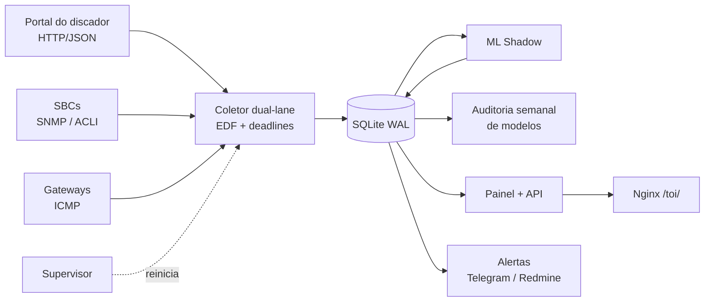

# TOI — Telecom Operational Intelligence

[](https://github.com/lerouxvinicius/TOI/actions/workflows/tests.yml)

**Plataforma de observabilidade com ML em produção para operações de contact center e telecom.** O TOI coleta a cada 10 segundos as métricas de filas de discagem, gateways, troncos SIP e SBCs, e usa um modelo em **modo shadow** para prever congestionamento **até 15 minutos antes** de ele acontecer. O modelo é governado por um contrato de dados que o desliga sozinho se a coleta mudar.

Projeto desenvolvido e operado por mim, de ponta a ponta: coleta, banco, painel, modelo, avaliação e deploy em servidor Linux.

> Todos os nomes de empresas, clientes, operadoras, hostnames, IPs e filas deste repositório são **fictícios**, e as métricas de ML vêm de dados **sintéticos** reproduzíveis.


## Destaques de engenharia de ML

| | |
|---|---|
| **Contrato de dados antes do modelo** | A coleta passa por homologação de frescor e fidelidade e é congelada num manifesto **SHA-256**. Se qualquer arquivo de aquisição mudar, o freeze é revogado e o modelo **se recusa a rodar** |
| **Deploy em shadow** | O modelo grava previsões explicáveis em `ml_shadow_prediction` sem alterar alertas nem decisões da operação |
| **Baseline antes de complexidade** | O v0 usa z-score robusto (mediana + MAD) sobre 6 h de histórico, com explicação em texto para a operação |
| **Avaliação sem vazamento** | Rótulo proxy com horizonte de 15 min, **split cronológico com embargo**, e métricas para classe rara (PR-AUC, precisão e recall com orçamento de alertas top 5%) |
| **Champion x challenger** | Uma auditoria semanal compara a regra atual, o shadow v0 e um candidato **HistGradientBoosting** |
| **Governança explícita** | A promoção para produção exige rótulos confirmados e validação prospectiva. Até lá, o modelo fica em shadow |

**Resultado no estudo de caso** (dados sintéticos, média de 3 filas no conjunto de teste):

| Modelo | PR-AUC | Precisão @5% | Recall @5% |
|---|---|---|---|
| Regra atual | 0,50 | 0,54 | 0,44 |
| **ML Shadow v0** (mediana + MAD) | **0,68** | **0,72** | **0,58** |
| Candidato HistGradientBoosting | 0,69 | 0,75 | 0,62 |

O baseline explicável já supera a regra com folga. O GBM ganha pouco, e esse ganho não compensa perder a explicabilidade enquanto não houver rótulos confirmados.

📄 **[Leia o estudo de caso completo](docs/ml-engineering.md)**: desenho, decisões, resultados e próximos passos.


## O que a plataforma faz

- **Visão executiva**: pressão operacional e capacidade por instância, com score, faixa de risco e cobertura das fontes.
- **Filas e discador**: P34 (sem circuito), P135 (congestionamento), hit rate, chamadas em discagem e em atendimento.
- **Infraestrutura**: ocupação de gateways e grupos de troncos, canais travados, inventário de SIP servers e sessões por realm nos SBCs (SNMP e ACLI, somente leitura).
- **Linha do tempo sincronizada**: todas as métricas no mesmo eixo, com eventos e zoom.
- **Inteligência**: diagnóstico automático, correlações, padrões e recorrências, análise de capacidade e recomendações.
- **Alertas**: confirmação de incidentes com janela de normalização, Telegram, receptor de traps SNMP e abertura de chamados no Redmine.
- **Assistente local**: perguntas em linguagem natural sobre os dados, respondidas por um LLM local (Ollama).
- **Acesso**: Argon2id, papéis (Administrador, Gestor, Operador, Consulta), CSRF e trilha de auditoria.

<p>
  
  
</p>

## Arquitetura



- **Coletor dual-lane**: agendador *earliest-deadline-first* com deadlines absolutos, lanes independentes para filas críticas, política adaptativa por instância, *circuit breaker* e cooldown por endpoint.
- **Supervisor**: reinicia componentes travados (no máximo três reinícios em dez minutos) e acompanha o avanço real dos dados, não só o processo.
- **Operação**: unidades systemd com *hardening* (`ProtectSystem=strict`, `NoNewPrivileges`, capabilities mínimas), health check a cada 2 min e backup diário com retenção.

## Stack

Python 3.12 · pandas · NumPy · scikit-learn · SQLite · matplotlib · pysnmp · requests · Playwright · Argon2 · JavaScript · Nginx · systemd · GitHub Actions · Ollama

## Rodando

```bash
python -m venv .venv
.venv\Scripts\activate          # Linux/macOS: source .venv/bin/activate
pip install -r requirements.txt

python demo/ml_case_study.py                          # estudo de caso de ML -> docs/ml/
python demo/run_demo.py                               # painel com dados fictícios
python -m unittest discover -s tests -p "test_*.py"   # 56 testes
```

O painel abre em **http://127.0.0.1:8099/toi/login** com o usuário `demo`. A senha está em [`demo/seed_demo.py`](demo/seed_demo.py).

## Estrutura

| Caminho | Conteúdo |
|---|---|
| `TOI_v1.10.6_DUAL_LANE_ML_SHADOW/` | Núcleo: coletor, supervisor, painel, **ML shadow, auditoria de modelos e homologação** |
| `TOI_v1.10.6.3.7.4.1_CONTINUOUS_ACTIVATION_R2/` | Inteligência de gateways em modo shadow |
| `TOI_INTELLIGENCE_READONLY_v1_2/` | Snapshot de saúde do sistema |
| `mgw/` | Media gateways e SBCs: SNMP, ACLI, capacidade SIP e chamados |
| `monitor_alertas.py`, `integracao_alertas.py` | Motor de alertas e confirmação de incidentes |
| `deploy/` | systemd, Nginx, publicação, rollback e smoke tests |
| `demo/` | Dados fictícios, painel local e estudo de caso de ML |
| `docs/` | Estudo de caso, gráficos e prints |
| `tests/` | Testes unitários, incluindo as garantias do pipeline de ML |

Os nomes de pasta versionados (`TOI_v1.10.6_…`) são os mesmos do deploy em produção. As unidades systemd e o manifesto de freeze apontam para esses caminhos.

## Configuração

As credenciais ficam fora do repositório, num arquivo de ambiente lido pelas unidades systemd. Veja [`.env.example`](.env.example).

---

<details>
<summary><b>English summary</b></summary>

**TOI** is an observability platform for contact-center/telecom operations, built and run end to end by me. It samples dialer queues, gateways, SIP trunks and SBCs every 10 s into SQLite, and serves a real-time dashboard with diagnosis and alerting.

ML engineering highlights:

- **Data contract first.** The acquisition layer must pass freshness and fidelity checks and is frozen in a SHA-256 manifest. Any change to collection code revokes the freeze, and the model refuses to run.
- **Shadow deployment.** An explainable robust baseline (median + MAD z-scores) predicts congestion up to 15 min ahead and logs predictions without touching alerts.
- **Leakage-safe evaluation.** Proxy label with a 15-min horizon, chronological 70/30 split with a 15-min embargo, and rare-class metrics (PR-AUC, precision/recall at a top-5% alert budget).
- **Champion vs. challenger.** A weekly audit compares the current rule, the shadow baseline and a HistGradientBoosting candidate.
- **Explicit governance.** Promotion requires confirmed incident labels and prospective validation.

On the reproducible synthetic case study, the shadow baseline raises PR-AUC from 0.50 (rule) to 0.68; the GBM candidate reaches 0.69. See [docs/ml-engineering.md](docs/ml-engineering.md). All company names, hosts, IPs and queues are fictional.

</details>
