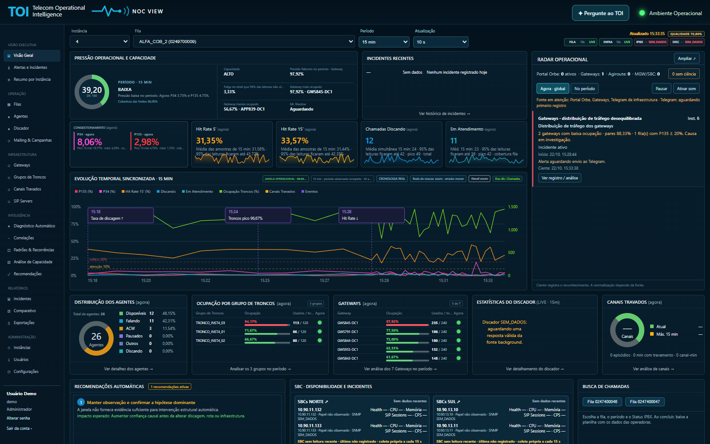
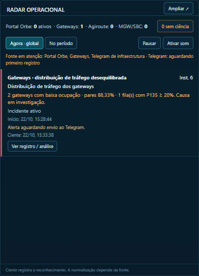
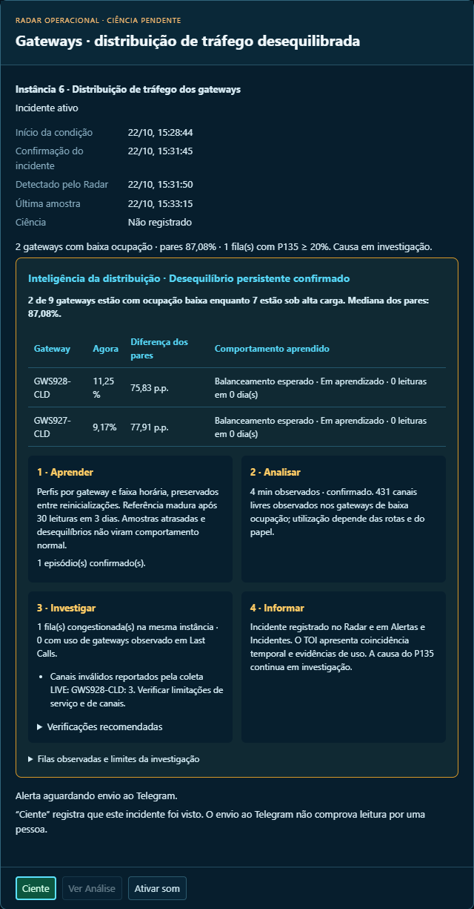
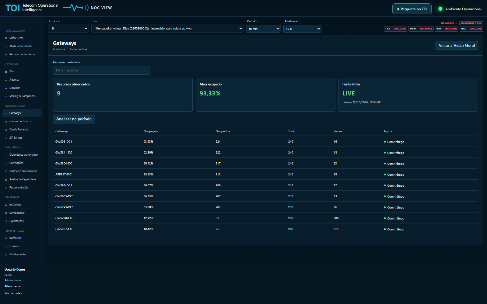
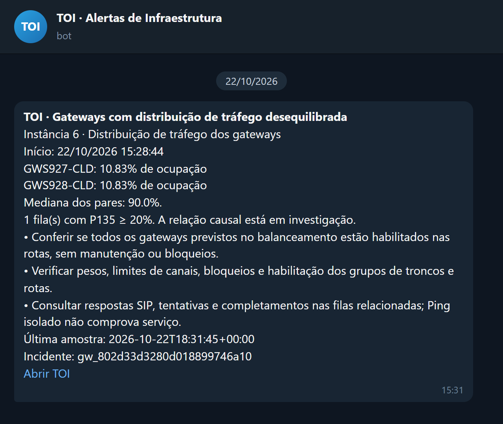
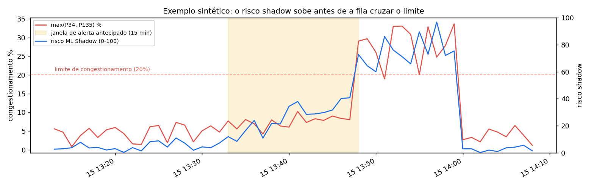
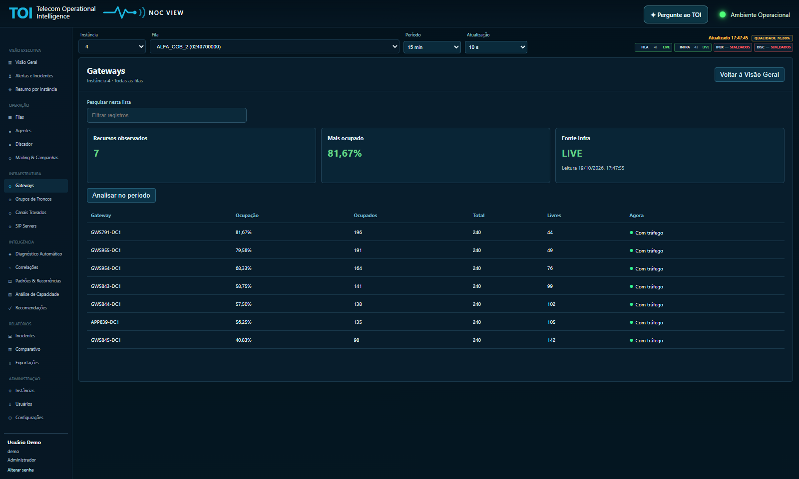
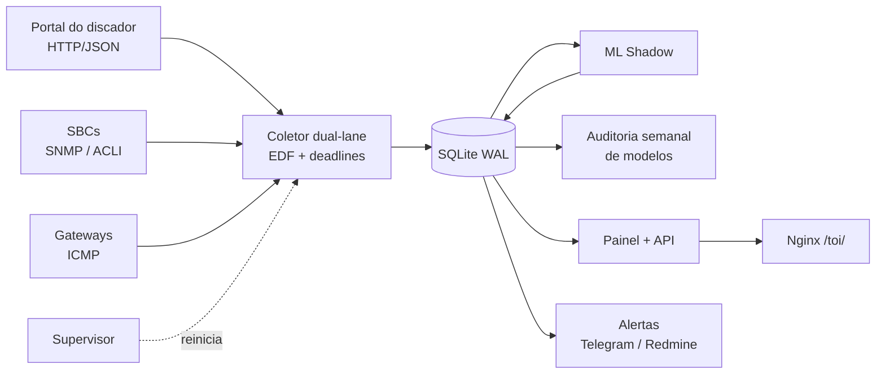

# TOI — Telecom Operational Intelligence

[](https://github.com/lerouxvinicius/TOI/actions/workflows/tests.yml)

**Plataforma de observabilidade com ML em produção para operações de contact center e telecom.** O TOI coleta a cada 10 segundos as métricas de filas de discagem, gateways, troncos SIP e SBCs, e usa um modelo em **modo shadow** para prever congestionamento **até 15 minutos antes** de ele acontecer. O modelo é governado por um contrato de dados que o desliga sozinho se a coleta mudar.

Projeto desenvolvido e operado por mim, de ponta a ponta: coleta, banco, painel, modelo, avaliação e deploy em servidor Linux.

> Todos os nomes de empresas, clientes, operadoras, hostnames, IPs e filas deste repositório são **fictícios**, e as métricas de ML vêm de dados **sintéticos** reproduzíveis.



## Destaques de operação

### Radar Operacional

Um único painel com **todos os incidentes ativos de todas as instâncias**: filas do discador (Portal), gateways, Agiroute e MGW/SBC. Ele roda num processo próprio a cada 5 segundos, independente de alguém estar com o painel aberto, e grava num banco separado, sem tocar na coleta.

- Cada incidente tem um ciclo de vida explícito: **condição observada → confirmação → incidente ativo → normalização confirmada**. Oscilações curtas não viram alarme.
- O alarme abre um aviso na tela, com som opcional, até alguém registrar **ciência**. A ciência e a normalização ficam gravadas como eventos do incidente, com horário.
- Visões **"Agora · global"** e **"No período"**, com histórico, contagem de recorrências e o estado de envio de cada alarme ao Telegram.

<p>
  
  
</p>

### Alarmes de baixa ocupação dos gateways

Numa instância em que o tráfego deveria ser balanceado, o TOI compara cada gateway com os pares e abre um alarme quando alguns ficam ociosos enquanto o resto está saturado. É capacidade parada enquanto as filas congestionam.

- **Regra explicável:** o gateway fica com no máximo 25% de ocupação e menos de 35% da mediana dos pares, pelo menos 40 p.p. abaixo dela, com a mediana em 80% ou mais e pelo menos metade dos gateways sob alta carga.
- **Contexto antes do alarme:** gateways em standby, rota de reserva ou receptivo ficam fora da comparação, conforme o papel confirmado pela operação.
- **Aprende o normal:** guarda um perfil de ocupação por gateway e faixa horária, maduro após 30 leituras em 3 dias, e passa a separar "queda em relação ao habitual" de "baixa habitual".
- **Confirma e acompanha:** o alarme abre após 3 minutos contínuos e 6 amostras, e só normaliza após 5 minutos de recuperação, registrando o P135 das filas antes e depois.
- **Não inventa causa:** cruza com as filas congestionadas (P135 ≥ 20%), as rotas observadas nas últimas chamadas e as respostas SIP 5xx, mas apresenta isso como coincidência e evidência, nunca como causa comprovada. Cada alarme vem com os passos de investigação.
- Também há alarmes de **gateway sem resposta ICMP** e de **gateway sem ocupação** com expectativa de tráfego, os dois confirmados por 10 minutos.



### Alarmes no Telegram

Os alarmes de gateway confirmados vão para um grupo no Telegram, com instância, gateways afetados, mediana dos pares, filas congestionadas, passos de investigação e o link para o TOI.

- **Saída transacional (outbox) no SQLite:** cada incidente gera no máximo uma mensagem de abertura e uma de normalização, mesmo com reinícios.
- **Sem mensagem duplicada:** se a resposta do Telegram se perde, o envio fica como "não confirmado" e não é repetido às cegas.
- **Respeita o Telegram:** usa o `retry_after` do erro 429, tenta de novo em falhas 5xx e não reenvia o histórico ao ligar o bot.
- **Só envia evidência fresca:** se a condição terminar antes do envio, a mensagem é cancelada.
- O token e o chat ficam em variáveis de ambiente, fora do repositório.



<sub>O texto da mensagem é o gerado pelo TOI para o alarme da demonstração (`RadarService.gateway_telegram_text`). Só o layout do chat foi reproduzido, porque a demo não envia mensagens.</sub>

## Destaques de engenharia de ML

| | |
|---|---|
| **Contrato de dados antes do modelo** | A coleta passa por homologação de frescor e fidelidade e é congelada num manifesto **SHA-256**. Se qualquer arquivo de aquisição mudar, o freeze é revogado e o modelo **se recusa a rodar** |
| **Deploy em shadow** | O modelo grava previsões explicáveis em `ml_shadow_prediction` sem alterar alertas nem decisões da operação |
| **Baseline antes de complexidade** | O v0 usa z-score robusto (mediana + MAD) sobre 6 h de histórico, com explicação em texto para a operação |
| **Avaliação sem vazamento** | Rótulo proxy com horizonte de 15 min, **split cronológico com embargo**, e métricas para classe rara (PR-AUC, precisão e recall com orçamento de alertas top 5%) |
| **Champion x challenger** | Uma auditoria semanal compara a regra atual, o shadow v0 e um candidato **HistGradientBoosting** |
| **Governança explícita** | A promoção para produção exige rótulos confirmados e validação prospectiva. Até lá, o modelo fica em shadow |

**Resultado no estudo de caso** (dados sintéticos, média de 3 filas no conjunto de teste):

| Modelo | PR-AUC | Precisão @5% | Recall @5% |
|---|---|---|---|
| Regra atual | 0,50 | 0,54 | 0,44 |
| **ML Shadow v0** (mediana + MAD) | **0,68** | **0,72** | **0,58** |
| Candidato HistGradientBoosting | 0,69 | 0,75 | 0,62 |

O baseline explicável já supera a regra com folga. O GBM ganha pouco, e esse ganho não compensa perder a explicabilidade enquanto não houver rótulos confirmados.

📄 **[Leia o estudo de caso completo](docs/ml-engineering.md)**: desenho, decisões, resultados e próximos passos.



## O que a plataforma faz

- **Visão executiva**: pressão operacional e capacidade por instância, com score, faixa de risco e cobertura das fontes.
- **Filas e discador**: P34 (sem circuito), P135 (congestionamento), hit rate, chamadas em discagem e em atendimento.
- **Infraestrutura**: ocupação de gateways e grupos de troncos, canais travados, inventário de SIP servers e sessões por realm nos SBCs (SNMP e ACLI, somente leitura).
- **Linha do tempo sincronizada**: todas as métricas no mesmo eixo, com eventos e zoom.
- **Inteligência**: diagnóstico automático, correlações, padrões e recorrências, análise de capacidade e recomendações.
- **Radar e alertas**: Radar Operacional global, alarmes de baixa ocupação e de indisponibilidade de gateways, confirmação de incidentes com janela de normalização, Telegram, receptor de traps SNMP e abertura de chamados no Redmine.
- **Assistente local**: perguntas em linguagem natural sobre os dados, respondidas por um LLM local (Ollama).
- **Acesso**: Argon2id, papéis (Administrador, Gestor, Operador, Consulta), CSRF e trilha de auditoria.

<p>
  
  
</p>

## Arquitetura



- **Coletor dual-lane**: agendador *earliest-deadline-first* com deadlines absolutos, lanes independentes para filas críticas, política adaptativa por instância, *circuit breaker* e cooldown por endpoint.
- **Supervisor**: reinicia componentes travados (no máximo três reinícios em dez minutos) e acompanha o avanço real dos dados, não só o processo.
- **Operação**: unidades systemd com *hardening* (`ProtectSystem=strict`, `NoNewPrivileges`, capabilities mínimas), health check a cada 2 min e backup diário com retenção.

## Stack

Python 3.12 · pandas · NumPy · scikit-learn · SQLite · matplotlib · pysnmp · requests · Playwright · Argon2 · JavaScript · Nginx · systemd · GitHub Actions · Ollama

## Rodando

Requer [Python](https://www.python.org/downloads/) 3.10 ou mais novo e [Git](https://git-scm.com/downloads). Todos os comandos rodam **dentro da pasta do projeto**. Copie e rode uma linha por vez.

**1. Baixe o projeto e entre na pasta:**

```bash
git clone https://github.com/lerouxvinicius/TOI.git
cd TOI
```

**2. Crie o ambiente virtual e instale as dependências.**

No Windows (Prompt de Comando):

```bat
python -m venv .venv
.venv\Scripts\activate
pip install -r requirements.txt
```

No Linux ou macOS:

```bash
python3 -m venv .venv
source .venv/bin/activate
pip install -r requirements.txt
```

**3. Escolha o que rodar:**

| O que faz | Comando |
|---|---|
| Estudo de caso de ML: gera métricas e gráficos em `docs/ml/` (cerca de 1 min) | `python demo/ml_case_study.py` |
| Testes: os 56 testes do projeto | `python -m unittest discover -s tests -p "test_*.py"` |
| Painel com dados fictícios. Abra http://127.0.0.1:8099/toi/login com o usuário `demo` (a senha está em [`demo/seed_demo.py`](demo/seed_demo.py)) e use `Ctrl+C` para parar | `python demo/run_demo.py` |

Na demo, a Instância 6 simula dois gateways com baixa ocupação. Cerca de 3 minutos depois de abrir o painel, o Radar confirma o alarme, desde que o relógio esteja na janela operacional (padrão: 8h às 21h).

Se o prompt já mostra `(.venv)`, o ambiente está ativo. Ao abrir um terminal novo, entre na pasta `TOI` e rode de novo só a linha de ativação.

## Estrutura

| Caminho | Conteúdo |
|---|---|
| `TOI_v1.10.6_DUAL_LANE_ML_SHADOW/` | Núcleo: coletor, supervisor, painel, **ML shadow, auditoria de modelos e homologação** |
| `TOI_v1.10.6.3.7.4.1_CONTINUOUS_ACTIVATION_R2/` | Inteligência de gateways em modo shadow |
| `TOI_INTELLIGENCE_READONLY_v1_2/` | Snapshot de saúde do sistema |
| `mgw/` | Media gateways e SBCs: SNMP, ACLI, capacidade SIP e chamados |
| `monitor_alertas.py`, `integracao_alertas.py` | Motor de alertas e confirmação de incidentes |
| `deploy/` | systemd, Nginx, publicação, rollback e smoke tests |
| `demo/` | Dados fictícios, painel local e estudo de caso de ML |
| `docs/` | Estudo de caso, gráficos e prints |
| `tests/` | Testes unitários, incluindo as garantias do pipeline de ML |

Os nomes de pasta versionados (`TOI_v1.10.6_…`) são os mesmos do deploy em produção. As unidades systemd e o manifesto de freeze apontam para esses caminhos.

## Configuração

As credenciais ficam fora do repositório, num arquivo de ambiente lido pelas unidades systemd. Veja [`.env.example`](.env.example).

---

<details>
<summary><b>English summary</b></summary>

**TOI** is an observability platform for contact-center/telecom operations, built and run end to end by me. It samples dialer queues, gateways, SIP trunks and SBCs every 10 s into SQLite, and serves a real-time dashboard with diagnosis and alerting.

Operations highlights:

- **Operational Radar.** A global view of every active incident (dialer queues, gateways, Agiroute, MGW/SBC) with explicit confirmation and normalization windows, on-screen alarms and acknowledgement tracking.
- **Low gateway occupancy alarms.** Each gateway is compared with its peers; idle gateways next to saturated ones open an explainable alarm, with learned hourly baselines, role-aware exclusions and investigation steps, never claiming a proven root cause.
- **Telegram alerts.** A transactional SQLite outbox sends at most one open and one normalization message per incident, never blindly resends after an ambiguous response, and honours Telegram rate limits.

ML engineering highlights:

- **Data contract first.** The acquisition layer must pass freshness and fidelity checks and is frozen in a SHA-256 manifest. Any change to collection code revokes the freeze, and the model refuses to run.
- **Shadow deployment.** An explainable robust baseline (median + MAD z-scores) predicts congestion up to 15 min ahead and logs predictions without touching alerts.
- **Leakage-safe evaluation.** Proxy label with a 15-min horizon, chronological 70/30 split with a 15-min embargo, and rare-class metrics (PR-AUC, precision/recall at a top-5% alert budget).
- **Champion vs. challenger.** A weekly audit compares the current rule, the shadow baseline and a HistGradientBoosting candidate.
- **Explicit governance.** Promotion requires confirmed incident labels and prospective validation.

On the reproducible synthetic case study, the shadow baseline raises PR-AUC from 0.50 (rule) to 0.68; the GBM candidate reaches 0.69. See [docs/ml-engineering.md](docs/ml-engineering.md). All company names, hosts, IPs and queues are fictional.

</details>
