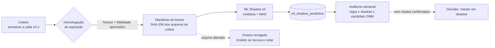
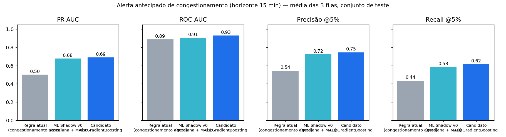

# Estudo de caso — ML em produção com governança

**Problema de negócio:** numa operação de discagem, quando P34 (*no circuit available*) ou P135 (congestionamento) passam de 20%, chamadas são perdidas e a equipe só reage depois do problema. O objetivo é **avisar até 15 minutos antes**, enquanto ainda dá para agir (redistribuir troncos, reduzir a taxa de discagem, acionar o fornecedor).

**Restrição que guiou todo o desenho:** um modelo não pode gerar alerta em uma operação real sem ter provado que (1) os dados que ele lê são confiáveis e (2) ele é melhor que a regra que já existe. Por isso o ML do TOI nasce em **modo shadow**: grava previsões, mas não altera score, diagnóstico, recomendação nem alerta.



## 1. Contrato de dados: o modelo só roda sobre aquisição homologada

Antes de qualquer modelo, a coleta foi homologada com dois testes automatizados:

- **Frescor** ([`homologar_freshness_v1_10_6.py`](../TOI_v1.10.6_DUAL_LANE_ML_SHADOW/homologar_freshness_v1_10_6.py)): numa janela de 20 minutos, mede a idade da última amostra, o P95 do intervalo entre snapshots e a cobertura mínima de amostras esperadas nas filas críticas.
- **Fidelidade** ([`validar_fidelidade_toi_v1_10_6.py`](../TOI_v1.10.6_DUAL_LANE_ML_SHADOW/validar_fidelidade_toi_v1_10_6.py)): em 10 ciclos, exige 100% de preservação do payload bruto, 100% de igualdade entre a fonte e o TOI quando os dois representam o mesmo instante, e P95 do intervalo entre snapshots de 30 a 40 s, conforme a fila.

Com os dois aprovados, [`congelar_aquisicao_v1_10_6.py`](../TOI_v1.10.6_DUAL_LANE_ML_SHADOW/congelar_aquisicao_v1_10_6.py) gera um **manifesto com o SHA-256** do coletor, do parser e das configurações de escopo. A cada execução, o ML Shadow recalcula os hashes ([`verify_freeze_manifest`](../TOI_v1.10.6_DUAL_LANE_ML_SHADOW/toi_ml_shadow_v1_10_6.py)). **Se qualquer arquivo da coleta mudou, o freeze é revogado e o modelo se recusa a rodar** até uma nova homologação. Isso evita o caso clássico de o modelo continuar "funcionando" sobre dados que mudaram de significado.

## 2. Modelo shadow v0: baseline robusto e explicável

[`toi_ml_shadow_v1_10_6.py`](../TOI_v1.10.6_DUAL_LANE_ML_SHADOW/toi_ml_shadow_v1_10_6.py), função `score_from_baseline`:

- Para cada fila, compara o minuto atual com as **últimas 6 horas** usando **z-score robusto (mediana + MAD)**, que não é arrastado por picos isolados.
- Cinco sinais com direção de negócio (P34↑, P135↑, hit rate↓, chamadas discando↑, taxa de discagem↑) + pressão dos troncos.
- Gera um **risco de 0 a 100**, uma classe (BAIXO/MÉDIO/ALTO) e **a explicação em texto** ("P135 acima do baseline (3,1 MAD-z)"; "Pressão de troncos 92%").
- Começar por um baseline estatístico foi intencional: não precisa de rótulo, é explicável para a operação e serve de referência que qualquer modelo mais complexo precisa superar.

## 3. Avaliação: rótulo honesto e split sem vazamento

[`toi_ml_homologation_audit_v1.py`](../TOI_v1.10.6_DUAL_LANE_ML_SHADOW/toi_ml_homologation_audit_v1.py) roda toda semana, só leitura:

| Decisão | Por quê |
|---|---|
| **Rótulo proxy:** P34 ou P135 ≥ 20% nos próximos 15 min | Não há incidentes confirmados rotulados; o proxy é observável e declarado como tal |
| Só entram minutos **ainda abaixo do limite** | Prever um congestionamento que já está acontecendo não tem valor |
| Janela futura exige **cobertura ≥ 10 dos 15 minutos** | Lacunas de coleta não viram falsos negativos |
| **Split cronológico 70/30 com embargo de 15 min** | Sem embaralhar o tempo; o embargo impede que o rótulo do treino enxergue o teste |
| Amostragem a cada 5 min | Reduz a autocorrelação entre exemplos vizinhos |
| Métricas: **PR-AUC, ROC-AUC, precisão e recall no top 5%** | A classe positiva é rara; o top 5% simula um orçamento fixo de alertas que a equipe consegue tratar |
| Três concorrentes: **regra atual**, **ML Shadow v0** e **HistGradientBoosting** | Um modelo só se justifica se superar a regra e o baseline |

As garantias de rótulo e de embargo têm testes automatizados em [`tests/test_ml_pipeline.py`](../tests/test_ml_pipeline.py).

## 4. Resultado no estudo de caso reproduzível

Os dados de produção não podem ser publicados. Para mostrar o pipeline de ponta a ponta, [`demo/ml_case_study.py`](../demo/ml_case_study.py) gera **14 dias sintéticos** de 3 filas, com episódios de congestionamento precedidos por sinais **e também falsos precursores** (sinais que não viram incidente). Depois roda as **mesmas funções de produção**.



| Média das 3 filas (teste) | PR-AUC | ROC-AUC | Precisão @5% | Recall @5% |
|---|---|---|---|---|
| Regra atual | 0,50 | 0,89 | 0,54 | 0,44 |
| ML Shadow v0 (mediana + MAD) | 0,68 | 0,91 | 0,72 | 0,58 |
| Candidato HistGradientBoosting | 0,69 | 0,93 | 0,75 | 0,62 |


**Leitura:** o baseline robusto já supera a regra atual com folga (PR-AUC 0,50 → 0,68). O GBM ganha pouco sobre o baseline, e o ganho não compensa perder a explicabilidade. **Esses números valem para os dados sintéticos** e servem para demonstrar o método. Os resultados completos estão em [`ml/case_study_results.json`](ml/case_study_results.json).

## 5. Decisão de governança

Mesmo com o candidato à frente, a auditoria registra **"candidato apenas shadow; faltam rótulos de incidente e validação prospectiva"** e `operational_approval: false`. O modelo não é promovido porque:

1. o rótulo é um proxy, não um incidente confirmado pela operação;
2. não houve validação **prospectiva** (avaliar previsões feitas antes de conhecer o resultado).

**Próximos passos:** registrar incidentes confirmados pela equipe como rótulo, rodar a validação prospectiva em shadow por algumas semanas, calibrar o risco como probabilidade e só então ligar o alerta, com o mesmo controle de freeze.

## Como reproduzir

```bash
pip install -r requirements.txt
python demo/ml_case_study.py                           # gera docs/ml/*
python -m unittest tests.test_ml_pipeline -v           # garantias do pipeline
```
